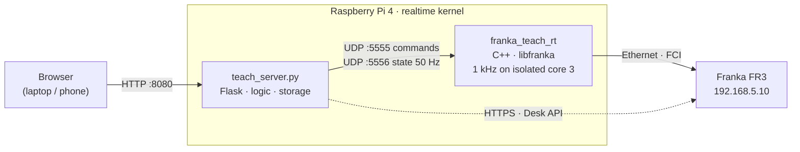

# arm-control

**Teach-and-repeat for a Franka Research 3 with exchangeable passive grippers — run from a
Raspberry Pi 4, operated from a web page.**

Mount a gripper, show the arm once how it picks up and puts down a part, teach a few spots on the
desk by moving the arm there — then click a spot on the desk map and the arm picks the part up
there, or puts it down. Sequences are stored relative to the part, so one recording works
everywhere on the desk.

> **Status (hackathon prototype):** the robot connection, free drive and mode switching run on the
> real FR3. Pick/place replay, guarded moves, presses and the automatic angle are tested against a
> simulated robot and still need their first run on the arm. See [Status](#status).

## Connecting to the Pi

| | |
|---|---|
| Hostname | `6B-PI4` (mDNS / `.local` does not work on the venue WiFi — use the IP) |
| User / password | `anton` / `1234` (also the `sudo` password) |
| WiFi | `3-UTUM-IOT` — your laptop must be on the same network (`MunichUrbanColab` isolates devices from each other) |
| IP address | DHCP, changes after the Pi was off for a while — last seen `10.23.60.42` |
| Web UI | `http://<ip>:8080` |
| SSH | `ssh anton@<ip>` |
| Robot network | Pi `eth0` = `192.168.5.12/24`, FR3 = `192.168.5.10` (Desk only reachable through the Pi) |

**Finding the IP** when it changed (from a Linux laptop on the same WiFi):

```bash
seq 1 254 | xargs -P 64 -I{} ping -c1 -W1 -q 10.23.60.{} >/dev/null 2>&1
ip neigh | grep -i e4:5f:01:55:34:90        # the Pi's WiFi MAC address
```

**Desk** from the laptop: `ssh -L 8443:192.168.5.10:443 anton@<ip>`, then open
`https://127.0.0.1:8443/desk/` (with `/desk/` — the bare address redirects and loses the port).

**Services** on the Pi: `sudo systemctl status|restart franka-teach-rt franka-teach-ui`, logs with
`journalctl -u franka-teach-rt -f`. Shut down cleanly before unplugging: `sudo poweroff`.

---

## Contents

- [Connecting to the Pi](#connecting-to-the-pi)
- [What it does](#what-it-does)
- [How it works](#how-it-works)
- [Concepts](#concepts)
- [Using it](#using-it)
- [Safety](#safety)
- [Troubleshooting](#troubleshooting)
- [Setting up a Pi](#setting-up-a-pi)
- [Development](#development)
- [Design decisions](#design-decisions)
- [Status](#status)

## What it does

| | |
|---|---|
| **Grippers** | Several passive gripper designs (no motors). Each has a **pick** and a **place** sequence and its own mass (needed for the force estimate). Choose the mounted one in a dropdown. |
| **Recording** | Move the arm **by hand** (free drive) or **jog** it, and add steps: stop points, continuous paths, waits, **guarded moves** (move until contact) and **presses** (hold a force, optionally while rotating — e.g. to push a spring mechanism onto the desk). |
| **Positions** | Named spots on the desk, taught by moving the arm above them. Shown on a desk map; optional desk coordinate system from two taught points. |
| **Operate** | Click a position: **Pick here** if the gripper is empty, **Place here** if it holds a part. Click an empty spot: **Go here**. Travel always goes over a safe height. |
| **Robot access** | **Unlock & activate FCI** and **Deactivate & lock** from the UI, so Desk is only needed for setup. |

## How it works



Two processes on the Pi, both started at boot as systemd services:

- **`franka_teach_rt`** (`app/rt/`) owns the robot connection and runs the 1 kHz control loop in
  one of three modes. It knows nothing about grippers or sequences — it only follows targets.
- **`teach_server.py`** (`app/scripts/`) is everything else: the web UI, recording, sequence
  execution, positions, storage, Desk actions. It is plain Python and runs anywhere.

| Path | Purpose |
|---|---|
| `app/rt/franka_teach_rt.cpp` | Realtime process: modes, smooth Cartesian follower, force mode, free drive, joint-limit protection, automatic recovery |
| `app/scripts/teach_server.py` | Web server and application logic |
| `app/scripts/teach_core.py` | Geometry and storage (no robot, no ROS) — sequence transforms, desk frame, JSON files |
| `app/scripts/robot_link.py` | The UDP protocol to `franka_teach_rt` |
| `app/scripts/desk.py` | Small client for Franka Desk's (undocumented) web API |
| `app/web/index.html` | The whole UI in one file |
| `app/test/` | Geometry tests and a simulated robot (see [Development](#development)) |
| `pi-setup/` | Setup scripts, systemd services, realtime tuning, libfranka test tools |

Data lives on the Pi in `~/franka_teach_data/` (`grippers/*.json`, `positions.json`, `desk.json`,
`settings.json`, `state.json`).

## Concepts

### Modes

| Mode | The arm… | Use it to… |
|---|---|---|
| **Hold** | holds its position by itself | do nothing / change grippers |
| **Free drive** | floats (gravity compensated, lightly damped) and stays where you let go | move it by hand: teach positions, record by hand |
| **Control** | is stiff and follows jog and sequence commands | jog, run sequences, record guarded moves and presses live |

The Pilot buttons on the wrist do not work for guiding while FCI is active — that is why free drive
exists. Don't push the arm in Control mode: it resists, and above ~30–40 N its collision reflex stops it.

### Gripper sequences

A **pick** starts with the empty gripper above the part and ends above it holding the part; a
**place** starts holding the part above the spot and ends empty above it. Steps:

| Step | Meaning |
|---|---|
| stop point | move there and stop (from *Add waypoint*) |
| pass-through point | move through without stopping (continuous recording; toggle with ⇄) |
| wait | pause |
| guarded move | move along an axis until the contact force is reached — fails if there is no contact within the distance |
| press | push down until a force is reached and hold it, optionally rotating about the vertical axis at a set speed, then release. *springy* for spring mechanisms, *hard* for rigid contact |

Sequences are stored **relative to their first pose** (horizontal offsets in its frame, heights
absolute — the desk height is the same everywhere). Replaying at a position moves the first pose
there.

### Positions and angles

Each position has an angle mode — only the rotation about the vertical axis changes, tilt stays as
recorded:

- **automatic** (default) — approach from the same direction *as seen from the robot base* as when
  recording. The arm then looks the same everywhere (mostly the base joint turns), which keeps the
  wrist away from its joint limits.
- **as recorded** — the absolute angle of the recording.
- **fixed** — the gripper angle at the moment the position was taught.

The app tracks whether the gripper is **empty** or **full** (starts empty), which decides between
*Pick here* and *Place here*.

## Using it

Open `http://<pi-address>:8080` (the Pi gets its address by DHCP; ours was `10.23.60.x`).

1. **Connect the robot.** Brakes unlocked and FCI active — with **Unlock & activate FCI** (header,
   or *Positions → Robot access*; save the Desk login there once) or in Desk. If someone else holds
   control in Desk, confirm with the **circle button on the Pilot**. The header turns to
   *robot connected*.
2. **Gripper.** *Grippers* tab → add it, enter its **mass** and centre of mass, select it as
   mounted (*Operate* tab).
3. **Record a pick.** Arm above a part (free drive), *Record* → add waypoints while guiding by hand
   (or jogging in Control mode), add guarded moves / presses where needed, return above the part,
   *Finish*. *Test where recorded* replays it at the same place. Same for *place*.
4. **Teach positions.** Free drive above each spot → *Positions* → name → *Save current arm
   position*. Optionally set the desk frame (origin + a point on the x axis).
5. **Operate.** Click a position on the map → *Pick here* / *Place here*.

Speeds: *Manual → Jog speed* for jogging, per-sequence speed in the gripper card, travel speed and
safe travel height under *Positions → Settings*.

## Safety

- Keep the **external activation device / stop** in reach whenever the arm is in Control mode.
- Try every new sequence, position or code change first at **low speed** (10–25 %) and with
  *Test where recorded*.
- **STOP** (or Esc) stops any motion; the force limit (default 25 N) aborts sequences; reflexes are
  cleared automatically after 0.5 s and the arm then holds still.
- Prefer positions in the **middle of the workspace** (0.3–0.7 m from the base). Near the edge of
  the reach the joints run into their limits.

## Troubleshooting

| Symptom | Cause | What to do |
|---|---|---|
| *robot not connected: FCI is not active* | FCI off (e.g. after a robot restart) | **Unlock & activate FCI** |
| *controller switch failed / robot did not switch* | robot in a reflex or brakes locked | **Recover errors**; check brakes in Desk |
| `joint_velocity_violation` | a joint got near the end of its range, where its allowed speed drops to zero | move closer to the middle of the workspace; use the automatic angle; lower speeds |
| `cartesian_motion_generator_*_discontinuity` | commanded motion not smooth (or lost packets) | should not happen with `franka_teach_rt`; report with the log |
| `communication_constraints_violation` | the 1 kHz loop missed packets | check `isolcpus` / IRQ tuning (`pi-setup/03`), CPU load on the Pi |
| arm sinks or rises in free drive | gripper mass wrong | correct the mass in the gripper card |
| *force limit exceeded* while travelling | fast motion, force estimate swings | lower travel speed, or raise the limit slightly |
| *Desk: control was not confirmed* | someone else holds control in Desk | press the Pilot circle button within 20 s |

Logs on the Pi: `journalctl -u franka-teach-rt -f` and `journalctl -u franka-teach-ui -f`.
Quick robot checks without the app (stop the services first): `pi-setup/tools/hold_test`
(link quality while holding still) and `move_test` (2 cm up and down).

## Setting up a Pi

Ubuntu Server 24.04 (64-bit) via Raspberry Pi Imager (user `anton`), then on the Pi from
`pi-setup/`:

| Step | Command | What |
|---|---|---|
| 1 | `sudo bash 01_base_ros.sh` | updates, swap, ROS 2 Jazzy base (only for libfranka's dependencies), realtime limits |
| 2 | `sudo pro attach <token> && sudo pro enable realtime-kernel --variant=raspi` | realtime kernel (Ubuntu Pro, free for personal use), reboot |
| 3 | `bash 02_build_libfranka.sh` | libfranka 0.20.5 (needs FR3 system ≥ 5.9.0; ours is 5.10.0) |
| 4 | `sudo bash 03_realtime_tuning.sh` | isolate core 3, Ethernet interrupts on it at FIFO 98, reboot |
| 5 | `sudo bash 04_connect_robot.sh 192.168.5.10` | static address on eth0 in the robot's subnet |
| 6 | `bash 05_install_app.sh` | build `franka_teach_rt`, install and start both services |

The robot IP is in `/etc/default/franka-teach`. Network notes from our setup: the laptop reaches the
Pi over a WiFi without client isolation; the Pi 4 needs `key-management: psk-sha256` in netplan for
WPA2 networks with protected management frames; the Pi has no clock battery, so NTP must stay on.
Desk itself is only on the robot's network — use the UI buttons, or a tunnel:
`ssh -L 8443:192.168.5.10:443 <pi>` → `https://127.0.0.1:8443/desk/`.

## Development

Everything except the realtime process runs and is testable **without a robot and without ROS**
(Python 3 with Flask and requests):

```bash
python3 app/test/test_teach_core.py            # geometry: transforms, angles, desk frame
python3 app/test/sim_test.py                   # the whole server against a simulated robot
python3 app/test/sim_test.py --serve           # UI with demo data → http://127.0.0.1:8090
```

The simulated robot follows targets, has a springy table for guarded moves and presses, and speaks
the same protocol as `franka_teach_rt` — use it for all UI and logic work. It does **not** model the
FR3's joint limits or reflexes; motion changes still need the real arm.

**Deploy to the Pi** (from `arm-control/`):

```bash
rsync -a --delete --exclude bin --exclude test app/ <pi>:franka_teach/
ssh <pi> 'cd franka_teach && g++ -O2 -std=c++17 -o bin/franka_teach_rt rt/franka_teach_rt.cpp \
  -I ~/franka_ros2_ws/install/libfranka/include -I /usr/include/eigen3 \
  -L ~/franka_ros2_ws/install/libfranka/lib -lfranka -lpthread \
  -Wl,-rpath,$HOME/franka_ros2_ws/install/libfranka/lib:/opt/ros/jazzy/lib/aarch64-linux-gnu \
  -Wl,-rpath-link,/opt/ros/jazzy/lib/aarch64-linux-gnu \
  && sudo systemctl restart franka-teach-rt franka-teach-ui'
```

(Python-only changes need just the rsync and `sudo systemctl restart franka-teach-ui`.)

**Protocol** between server and realtime process — one-line text datagrams:

| Command (→ :5555) | |
|---|---|
| `mode idle\|follow\|free` | switch mode (follow decelerates before leaving) |
| `target x y z qx qy qz qw` | new target pose for the follower (base frame, metres) |
| `stop` · `speed s` | brake and hold · speed scale 0.01–1 |
| `force 1 F gain v_approach v_contact max_depth abort` · `force 0` | force mode along z on / off |
| `load m cx cy cz` · `collision` · `recover` | robot parameters and error recovery (executed in idle) |

State (→ :5556, 50 Hz): `S <mode> <robot_mode> <success_rate> <O_T_EE ×16> <wrench ×6> <follower ×8>
<counter>|<errors>|<last error>`, or `E <reason>` while there is no robot connection.

## Design decisions

- **No ROS in the control path.** We started with ROS 2 / franka_ros2 / ros2_control. On the Pi it
  lost about 0.2 % of the 1 kHz control packets (plus a mode-switch race in franka_hardware and a
  lot of CPU for the full-state broadcaster), and every lost command *during motion* made the robot
  abort with an acceleration-discontinuity reflex. libfranka directly runs at 100 % on the same
  hardware. If ROS integration is needed (RViz, MoveIt, other ROS systems), add a bridge node that
  talks to `franka_teach_rt` — don't move the control loop back.
- **Smooth by construction.** Targets can jump (jog clicks, waypoints), so the follower plans with
  velocity/acceleration limits and passes the result through two 15 ms filters; libfranka's rate
  limiter is a second safety net. The first command of a motion equals the robot's last commanded
  pose (`O_T_EE_c`).
- **Joint limits.** The FR3's allowed joint speed depends on the joint position and drops to zero
  at the ends of the range. The follower slows down when a joint uses more than half of its current
  limit; free drive damps harder there.
- **Force.** Presses use admittance control on the robot's external force estimate
  (`O_F_ext_hat_K`, negative z when pressing down) — no torque controller needed. The estimate has a
  few newtons of drifting offset, so it is tared before every guarded move and press. Gains for
  *springy* and *hard* contact were tuned in an offline simulation.
- **Realtime on a Pi 4.** Ubuntu's PREEMPT_RT kernel, core 3 isolated for the loop and the Ethernet
  interrupts (FIFO 98 above the loop). Measured worst-case scheduling latency ~60 µs under full load.

## Status

| | |
|---|---|
| ✅ on the robot | 1 kHz link at 100 %, free drive, mode switching, Desk login and taking control, libfranka motion tests |
| 🧪 simulation only | pick/place replay at positions, guarded moves, presses, automatic angle, *Go here*, joint-limit protection, automatic recovery |
| 🔧 open | *Unlock & activate FCI*: Desk 5.10 uses `/desk/api/joints/unlock` and `/control-token/fci` — call format still to be confirmed |

Ideas: offline joint-limit check of sequences before running them (FR3 model via pinocchio),
per-gripper TCP offset, tracking which positions hold a part, a tool-change position, importing
Desk tasks, a ROS bridge.
